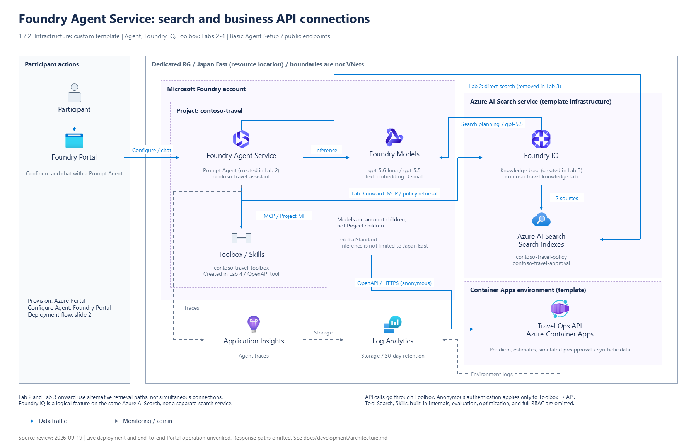

# Workshop architecture

[Developer guide](README.md) / [Core workshop scope](feature-support-matrix.md)

For material developers checking service responsibilities, communication paths,
authentication, and material handoffs. `infra/main.bicep` and each Lab's
implementation are the architecture sources of truth.
For participant operations, start with [Lab 1](../../labs/01-setup.md).

## Architecture diagrams

[Full-size PNG](../images/azure-architecture-01.png) ·
[Editable PowerPoint (2 slides)](../diagrams/azure-architecture.pptx) ·
[Overview JSON](../diagrams/azure-architecture.json) ·
[Image and icon attribution](../images/ATTRIBUTION.md#architecture-diagrams)

Slide 1 shows **custom-template infrastructure and service connections added in
Labs 2–4**. `infra/main.bicep` defines the infrastructure; its generated
`infra/azuredeploy.json` is applied to an existing dedicated RG.
The Prompt Agent, Foundry IQ Knowledge base, and Toolbox are created in the Labs,
not the template, so the corresponding nodes identify their creation Lab.
Codespaces / Dev Container and Hosted Agent are omitted from this diagram.

Slide 2 separates participant Azure Portal operations from deployment, initialization,
and validation inside the custom template. It omits full RBAC definitions, internal
Tool Search / Skills / built-in-tool processing, and evaluation / optimization jobs.
Boundaries are not virtual networks, and the diagrams are not evidence of an
in-progress deployment's success or failure.
Resources are placed in Japan East, but `GlobalStandard` models do not guarantee
a regional boundary for inference processing.
Existing diagrams / screenshots may contain Japanese or older UI and remain
illustrative, not evidence for the current English revision.

## Service connections and creation timing

| Visual | Meaning |
|---|---|
| Solid blue line | Agent inference, retrieval, and tool calls; responses omitted. Search paths in Lab 2 and Lab 3 onward replace one another; they are not simultaneously active. |
| Dashed gray line | Monitoring on slide 1; participant / internal-processing order on slide 2. |
| Dotted purple arrow | Resource, connection, and RBAC dependencies, not instructions to execute every resource sequentially. |
| Dashed purple frame | Foundry resource hierarchy, logical Search functions, Container Apps environment, or processing responsibilities; not network boundaries. |

| Connection | Behavior defined by this repository |
|---|---|
| Agent Service → Azure AI Search | Lab 2 performs Semantic search on `contoso-travel-policy`. Lab 3 removes this direct-search tool. |
| Agent Service → Foundry IQ → Search indexes | Path from Lab 3 onward. The Knowledge base resides on the same Search service and uses 2 indexed knowledge sources, policy and approval. It does not add another Search service. |
| Foundry IQ → Foundry Models | Lab 3 sets `gpt-5.5` / Medium for retrieval planning. Initial-data embeddings are generated separately by Python inside Deployment Scripts. |
| Agent Service → Toolbox → Travel Ops API | Lab 4 keeps Knowledge and connects Toolbox through MCP / Project Managed Identity. Toolbox exposes 4 OpenAPI operations and calls the API over anonymous HTTPS; this is not a direct Agent-to-API connection. |

The Foundry project and model deployments are separate child resources under the
same Foundry account. The template prepares the Search AAD connection, model access
for the Search identity, and Application Insights connection using Project Managed
Identity. It also predefines the MCP connection; the target Knowledge base itself
is created later in the exercises.
Application Insights stores data in the shared Log Analytics workspace; Container
Apps environment logs are configured to go to that same workspace.

## Participant operations and template internals

[Full-size deployment / initialization PNG](../images/azure-architecture-02.png) ·
[Deployment / initialization JSON](../diagrams/azure-architecture-deployment.json)

Participants manually create the RG, load the template, start against the existing
RG, and check completion. They do not run CLI / Python initialization on their PCs.
Internal resources, connections, and RBAC follow Bicep dependencies; Deployment
Scripts starts when prerequisites are ready.
Resource-creation and permission boxes separate responsibilities, not a fully
sequential resource-creation pipeline.

Deployment Scripts uses a dedicated UAMI to retrieve pinned source and prepare
an isolated Python environment. `bootstrap_data.py` generates document embeddings
and seeds Search data in policy, then approval order.
It then registers 2 evaluation / optimization datasets and the shared rubric.
`--prepare-only` exits after registration; it does not run evaluation / optimization
jobs or create Agents.
Final validation covers connection information, key resources, the intended
participant's Foundry User role, API health, Search schema, and document counts.
It is not an end-to-end test of all services operated as the participant.
Only after every stage succeeds does it return `workshopContext.setup_status = complete`.
Helper ACI / Storage are cleaned up on success, retained for 1 day on failure,
and subject to a 1-hour execution limit.
The bootstrap-only UAMI and permissions remain until dedicated RG deletion.

## Execution locations by Lab

Slide 1 shows Prompt Agent connections. Lab 7 local execution and the Lab 8 Hosted
workflow are outside the diagram, but their reuse of services is summarized below.

| Execution target | Location | Dependencies |
|---|---|---|
| Prompt Agent (Labs 3–6) | Foundry Agent Service | Primary model and Foundry IQ; Toolbox added in Lab 4. |
| Plain Agent / Harness (Lab 7) | Codespaces or local Dev Container | Both directly call the primary model and Foundry IQ. Harness also uses Toolbox tools and Skills. |
| Hosted workflow (Lab 8) | Foundry Agent Service after remote source code build | `intake_agent` → `policy_agent` → `reviewer_agent`. All use the primary model; only `policy_agent` calls Foundry IQ. |

Lab 7 SDK / MCP directly calls models, Foundry IQ, and Toolbox.
The local Harness does not run inside Foundry or retrieve through the Hosted Agent.
The Lab 8 workflow does not call Toolbox, Skills, or Travel Ops API.
Evaluation and Agent Optimizer use the same `gpt-5.5` deployment as Foundry IQ retrieval planning.

The OpenAPI connection from Toolbox to the synthetic-data Travel Ops API is anonymous
HTTPS. This exception does not apply to Foundry, Toolbox, or Search authentication.
Those use Microsoft Entra ID, project / runtime identities, and narrowly scoped
role-based access control (RBAC).

## Editing architecture diagrams

The main deliverable is `docs/diagrams/azure-architecture.pptx`.
Official SVG icons, names, and descriptions are grouped by service; boundaries,
text, and communication lines are individual PowerPoint objects, not a single pasted image.
Find objects by `service:`, `boundary:`, and `flow:` in the Selection Pane.
Connection endpoints follow moved services, but intermediate elbow routes require manual adjustment.

Use PNGs for viewing and desktop PowerPoint for editing.
During the recorded diagram update, Copilot's built-in preview did not render
PPTX SVG extension images or native connectors. This did not mean data was missing.
PNGs were exported from desktop PowerPoint.

The 2 JSON files for service connections and deployment / initialization are the
diagram specifications. The 11 official SVGs used are bundled in
`docs/diagrams/azure-icons/`, with [sources / SHA-256](../diagrams/azure-icons/manifest.json)
recorded. Manual PPTX edits do not flow back into JSON. After saving a manually
edited version, do not overwrite it from JSON without incorporating those changes.

Editing existing native objects in desktop PowerPoint is a supported maintenance
path. Update the corresponding JSON specifications in the same change.
For text-only translations, preserve service objects, connections, icon contents,
and their relationships; translate text in shapes and speaker notes consistently
with the JSON. Desktop PowerPoint COM automation on Windows can make these same
native-object edits and export images without flattening the editable slides.

Save the edited PPTX and export both slides from desktop PowerPoint as
`azure-architecture-01.png` and `azure-architecture-02.png`, at 1800 × 1160 pixels.
Check both PNGs for clipped text, crossings, line direction, and agreement with
the JSON and editable PPTX. Keep the PPTX in `docs/diagrams/` and PNGs in
`docs/images/`, and record label translation and export changes in
[attribution](../images/ATTRIBUTION.md#architecture-diagrams).

The personal `azure-architecture-powerpoint` Skill was used for earlier generation,
but its scripts are not included here. It is optional, not a prerequisite for
repository development or native PowerPoint editing. There is no built-in
repository regeneration command. If that optional generator is separately
available, its requirements are Windows, desktop PowerPoint, Python 3.10 or later,
and pywin32. Use an existing suitable virtual environment; restore pywin32 from
that generator's `requirements.txt` only if missing. Its earlier workflow stops
when outputs already exist, so use an empty output location and incorporate all
manual changes into the JSON before regenerating.

For architecture changes, update the English-primary README, any explicitly
maintained README variant, and this document together; no Japanese counterpart
is promised on this branch.

Before publishing to a public repository, verify that organizational sensitivity
labels permit publication and that personal author / last-modifier metadata is
absent. Set sensitivity in PowerPoint according to organizational policy; do not
bypass it by removing labels.

Old [draw.io](../diagrams/azure-architecture.drawio) and
[SVG](../images/azure-architecture.svg) files are retained as history from before
the update, not sources of truth or regeneration inputs for the current architecture.

Procedure-oriented diagrams remain available:

- [Environment creation overview](../../docs/images/workshop-architecture.svg)
  ([editable Excalidraw data](../../docs/diagrams/workshop-architecture.excalidraw))
- [Learning flow](../../docs/images/workshop-learning-flow.svg)
  ([editable Excalidraw data](../../docs/diagrams/workshop-learning-flow.excalidraw))

### Diagram assumptions and sources

The recorded review date is **2026-09-19**.
The original request was "Use the Azure architecture diagram skill to update the
current architecture diagram!" An additional instruction, "We are not using
Codespaces now; we are deploying with a custom template," excluded Codespaces
from the diagram. Later connection-addition instructions added Labs 2–4 Agent
Service, Search, Foundry IQ, and Toolbox-mediated API connections to slide 1 and
split slide 2 into "Participant operations from Azure Portal" and "Custom template internals."
These are historical diagram-update decisions, not English release validation.

| Diagram decision | Repository evidence reviewed |
|---|---|
| Replace direct Search with IQ | [Lab 2](../../labs/02-prompt-agent.md#5-connect-an-azure-ai-search-tool), [Lab 3](../../labs/03-rag-foundry-iq.md#2-connect-the-knowledge-base-to-the-agent), reviewed as Portal procedure definitions. |
| IQ's 2 sources and retrieval planning model | [Lab 3 settings](../../labs/03-rag-foundry-iq.md#1-create-a-foundry-iq-knowledge-base): `gpt-5.5`, Medium, 2 indexes. |
| Agent → MCP Toolbox → OpenAPI API | [Toolbox connection](../../scripts/connect_toolbox.py#L37-L63), [MCP connection / Agent attachment](../../scripts/create_toolbox.py#L403-L513), [OpenAPI authentication](../../scripts/create_toolbox.py#L83-L132), [Lab 4](../../labs/04-tools-toolbox.md). |
| API's 4 operations and synthetic-data handling | [FastAPI router](../../src/travel-api/travel_api/adapters/api/routes.py#L49-L145), [OpenAPI source](../../assets/openapi/travel-ops.openapi.json). Simulation, not real approval. |
| Infrastructure, dependencies, completed outputs | [Bicep](../../infra/main.bicep#L113-L709), [participant operations](../../labs/01-setup.md#3-wait-for-successful-initialization). |
| Pinned source and isolated Python | [Deployment Scripts wrapper](../../scripts/bootstrap-custom-template.sh#L30-L180). |
| Seed → evaluation materials → validation → complete | [Initialization order](../../scripts/bootstrap_custom_template.py#L163-L251), [success checks](../../scripts/bootstrap_custom_template.py#L263-L339), [completed outputs](../../scripts/bootstrap_custom_template.py#L365-L401). |
| Initialization Python generates embeddings | [OpenAI client generation](../../scripts/bootstrap_data.py#L1068-L1107). Search is not depicted as embedding initial data. |
| Initialization does not run evaluation / optimization jobs | [`--prepare-only` early exit](../../scripts/run_evaluation.py#L724-L771). |
| Post-initialization validation scope | [Validation checks](../../scripts/validate_environment.py#L471-L591). Checks the Foundry User role grant, not an operational test of every participant permission. |

At that historical review, the template's pinned `sourceRevision` was compared with
5 bootstrap files in the working tree. Only a reference in the `run_evaluation.py`
docstring differed; the depicted initialization logic matched.
This is not a comparison against an unpublished English release.
The [architecture contract tests](../../tests/contract/test_architecture_diagrams_contract.py)
also verify rejection of 6 incorrect specimens: direct API connection, IQ as a
separate service, simultaneous search paths, participant-run initialization,
evaluation jobs during initialization, and completion output before validation.

The recorded diagram update did not deploy to Azure or run all Labs.
No Azure state query was made for an in-progress deployment, so its outcome was
unverified. Basic Agent Setup service-managed storage, full RBAC definitions,
and Labs 7–8 paths are omitted.

| Reviewed topic | Microsoft Learn primary source |
|---|---|
| Projects and models under a Foundry account | [projects (2026-05-01)](https://learn.microsoft.com/en-us/azure/templates/microsoft.cognitiveservices/2026-05-01/accounts/projects), [deployments (2026-05-01)](https://learn.microsoft.com/en-us/azure/templates/microsoft.cognitiveservices/2026-05-01/accounts/deployments) |
| Foundry IQ and Azure AI Search relationship | [What is Foundry IQ?](https://learn.microsoft.com/en-us/azure/foundry/agents/concepts/what-is-foundry-iq), [Agentic retrieval](https://learn.microsoft.com/en-us/azure/search/agentic-retrieval-overview) |
| Deployment Scripts identity, helper resources, outputs | [Use deployment scripts in ARM templates](https://learn.microsoft.com/en-us/azure/azure-resource-manager/templates/deployment-script-template) |
| Container Apps environment logs | [Log storage and monitoring options](https://learn.microsoft.com/en-us/azure/container-apps/log-options) |
| Application Insights / Log Analytics relationship | [Workspace-based Application Insights](https://learn.microsoft.com/en-us/azure/azure-monitor/app/create-workspace-resource) |
| GlobalStandard inference location | [Foundry deployment types](https://learn.microsoft.com/en-us/azure/foundry/foundry-models/concepts/deployment-types) |

The diagram includes Preview connection definitions used by these materials; it
does not guarantee GA status or SLA for entire features.
See [attribution](../images/ATTRIBUTION.md#architecture-diagrams) for icon usage terms.

## Responsibilities

| Owner | Responsibility |
|---|---|
| Participant / Azure Portal | Manually create 1 dedicated RG, select it in the template, retain other defaults, check success, and delete the RG at the end. |
| Bicep / generated ARM | Manage Foundry, models, Search, API, monitoring, connections, and narrowly scoped RBAC in the existing RG. |
| Deployment Scripts | Seed 2 Search indexes, prepare / validate evaluation data and rubrics, and return completed connection information. |
| GitHub | Store shared Skill ZIPs / OpenAPI in `assets/`, Notebooks, scripts, and Python source. |
| Foundry Portal | Operate Prompt Agent, Foundry IQ, Toolbox, evaluation, optimization, and traces. |
| Codespaces / local Dev Container | Shared Notebook runtime for Labs 7–8, personal Azure CLI sign-in, and Hosted Agent creation / deletion. |

The Portal template is generated from `infra/main.bicep`.
Initialization prepares data; participants create learning Agents, Knowledge bases,
and Toolbox during exercises.

## Azure resources and constraints

The dedicated Japan East RG contains:

- Foundry project `contoso-travel`, using **Basic Agent Setup**.
- `GlobalStandard` primary, evaluation / optimization, and embedding models.
  See [administrator model quotas](../../docs/admin/prerequisites.md#model-quotas)
  for model names and capacities.
- Search **Basic** and 2 indexes: `contoso-travel-policy`, `contoso-travel-approval`.
- Travel Ops API on Container Apps with a public endpoint.
- Log Analytics and Application Insights.
- System-assigned identities, narrowly scoped RBAC, and a bootstrap-only user-assigned identity.

The Search resource connection uses AAD authentication; Knowledge base MCP and
Application Insights connections use **Project Managed Identity**.
See [infrastructure connection schemas](../../infra/README.md#connection-schema-exceptions)
for names, API versions, and settings. Foundry / Search local authentication is
disabled and public endpoints are enabled.

Application Insights and Log Analytics collect / display traces.
Automatic alerts are outside the exercises; the template creates no alert rules
or notification groups. `Microsoft.AlertsManagement` registration is not a prerequisite.
See [administrator guidance](../../docs/admin/troubleshooting.md#application-insights-automatic-alerts)
for Azure's separately created default alerts.

See the [infrastructure implementation guide](../../infra/README.md) for initialization
infrastructure and [administrator prerequisites](../../docs/admin/prerequisites.md)
for release defaults / pre-publication checks.

## Materials and connection information handoff

- Lab 4 directly downloads `assets/skills/travel-estimation.zip`,
  `assets/skills/preapproval-simulation.zip`, and
  `assets/openapi/travel-ops.openapi.json` from GitHub.
  Skill ZIPs place `SKILL.md` at their root; source is maintained in `data/skills/`.
  Change only OpenAPI `servers[0].url` to the participant's ARM `travelApiBaseUrl`.
- ARM outputs `resourceOutputs`, `workshopContext`, `travelApiBaseUrl`, and
  `foundryPortalUrl`. Only successful initialization returns
  `workshopContext.setup_status = complete`.
- Container `notebooks/00-setup.ipynb` uses `scripts/configure_workshop.py` to
  retrieve successful environment information from subscription ID / RG name and
  save `.workshop/context.json`. Schema `2.0` uses canonical
  `resource_outputs.<key>.value`.
- Dev Container post-create processing prepares separate Python 3.12 management
  and Python 3.13 Hosted virtual environments outside the checkout.
  It does not authenticate to Azure or create environments.
  Participants sign in to Azure CLI before Notebooks; this is separate from GitHub / Portal authentication.
- Use **Python (Foundry Workshop)** for setup and **Python (Foundry Hosted Agent)**
  for Labs 7–8. Deployment / deletion cells explicitly call the management virtual
  environment and require confirmation input.

Shared Skill ZIPs and source code ZIPs submitted to the Hosted API serve different
purposes; both are used. This is not environment-specific material archive distribution.

## End-of-workshop operations

Save / export work, delete every Hosted Agent version, and stop / delete the
Codespace, in that order. Then use **Delete resource group** in Azure Portal to
delete the participant's dedicated RG and verify completion.
Deleting deployment history alone does not delete resources.
Follow [Lab 9](../../labs/09-observability-cleanup.md).
